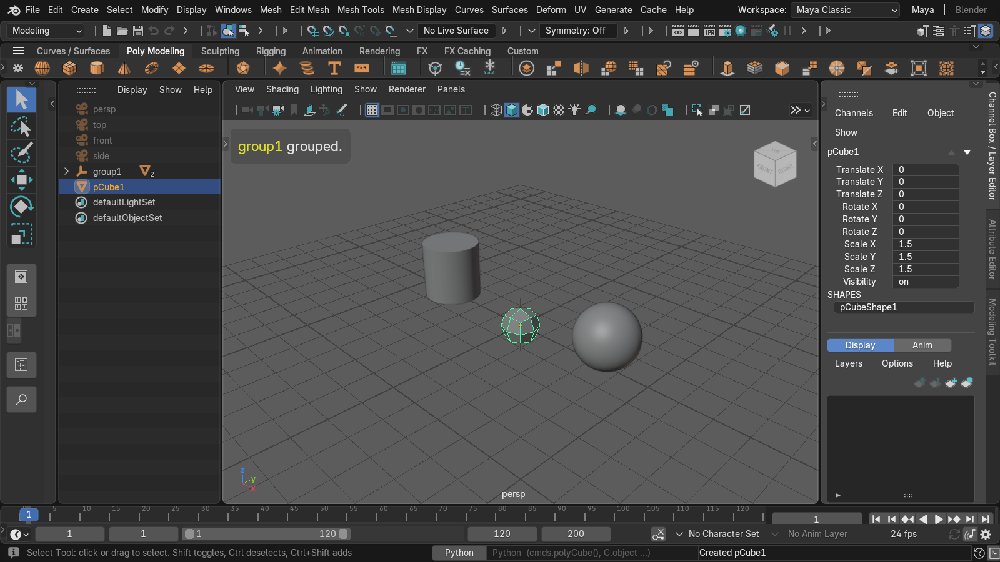
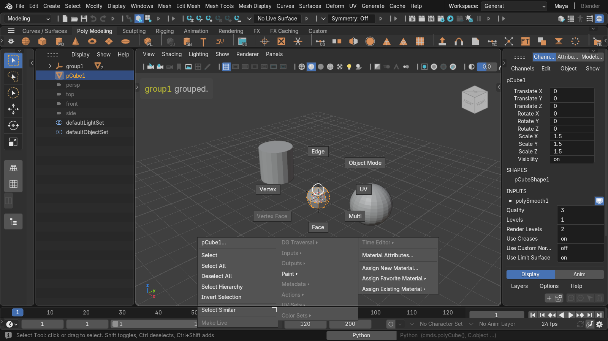
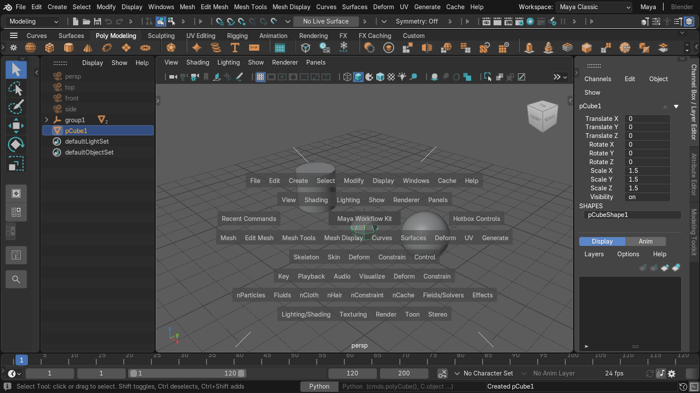
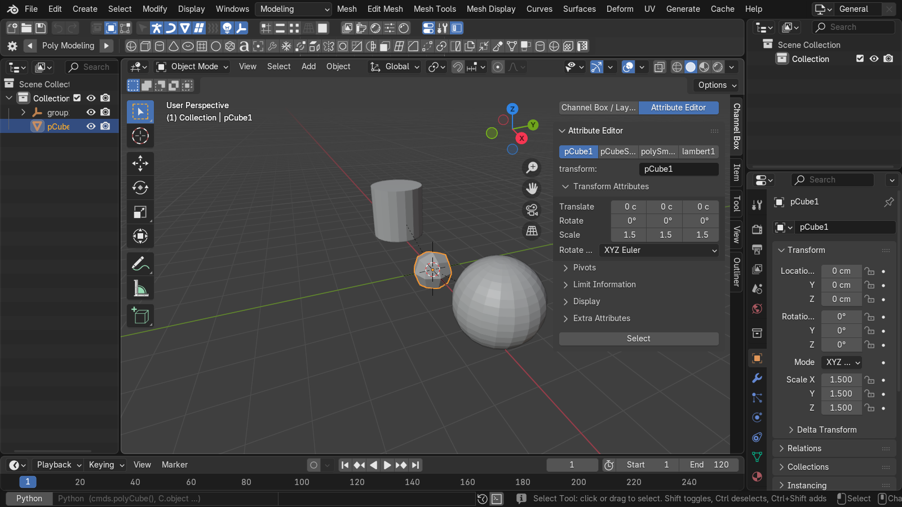
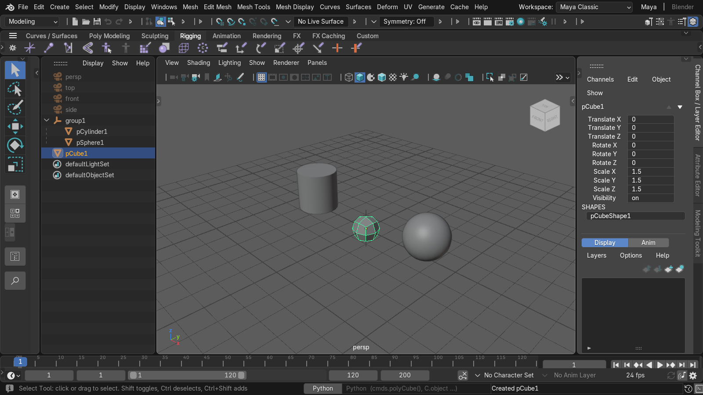

# Allset for Maya Users

**The whole Maya workflow in Blender, in one install.**

Other tools give you one piece at a time — a pivot, a keymap, a shelf, a theme. Allset brings the whole Maya workflow
into Blender at once: hotbox and marking menus, Channel Box, Attribute Editor, Outliner, menu sets, shelves, option
windows, Freeze / History concepts, centimetre units and pCube1-style naming. *한국어는 아래.*

다른 도구는 한 조각씩 줍니다 — 피벗, 키맵, 셸프, 테마. Allset 은 Maya 워크플로우 전체를 한 번에 Blender 로 옮깁니다:
핫박스·마킹메뉴, Channel Box, Attribute Editor, Outliner, 메뉴셋, 셸프, 옵션 창, Freeze / History 개념, cm 단위,
pCube1 이름 붙이기. 대상: Blender 4.2+ (4.5 LTS), Maya 2022 를 쓰던 사람.



> Autodesk and Maya are registered trademarks or trademarks of Autodesk, Inc., and/or its subsidiaries and/or
> affiliates in the USA and/or other countries. This project is an independent, free and open-source (GPL)
> extension for Blender. It is not affiliated with, endorsed by, sponsored by, or otherwise approved by
> Autodesk, Inc. or the Blender Foundation. It contains no Autodesk code, icons, MEL scripts or other Autodesk
> assets; references to Maya are solely to describe compatibility and the intended audience.

> (한국어 요지) Autodesk 와 Maya 는 Autodesk, Inc. 의 상표입니다. 이 프로젝트는 Autodesk·Blender Foundation 과 관계없는
> 독립 GPL 익스텐션이며 Autodesk 코드·아이콘·MEL·자산을 포함하지 않습니다. Maya 는 호환성과 대상 사용자를 설명하는
> 데만 씁니다.

---

## 한국어

### 설치

1. `allset-<버전>.zip` 을 받습니다. 소스에서 만들려면 `python tools/build.py` 를 실행합니다(결과: `dist/`).
2. Blender 4.5 LTS (4.5.x; 5.x 는 아직 — step 117)에서 *Edit > Preferences > Get Extensions > ▾ > Install from Disk…* 로 zip을 고르거나,
   zip을 Blender 창에 끌어다 놓습니다. 명령줄 설치:
   `blender --command extension install-file -r user_default --enable allset-<버전>.zip`
3. 처음 켜면 키맵이 **"Maya-style"** 로 바뀌고 Maya 내비게이션 환경설정이 적용됩니다(끄면 원래 값으로 돌아갑니다).
   새 설정의 첫 실행에서 나오는 *Quick Setup* 창은 키맵을 "Blender" 로 덮어쓸 수 있으니 ESC로 닫거나, 나중에
   *Preferences > Add-ons > Allset > Activate Maya Keymap* 을 누르세요.
4. *Preferences > Add-ons > Allset > Install Maya Layout* → *File > New > Allset* 으로 Maya 레이아웃을 엽니다
   (Outliner 왼쪽, 위쪽 Status Line·Shelf, 오른쪽 Channel Box/AE, 아래 타임라인). 같은 곳에서 Maya 테마를 적용/되돌립니다.
5. 레거시 애드온 zip(`allset-<버전>-legacy.zip`)도 같은 소스에서 만들어집니다.

### 기능

| 영역 | 내용 |
|---|---|
| 키맵 | Industry Compatible 데이터를 바탕으로 만든 "Maya-style" 키컨피그. Q/W/E/R, 선택 수정키(Shift 토글, Ctrl 해제, Ctrl+Shift 추가), 4/5/6/7 표시, 1/2/3 스무스 미리보기, F8–F11 컴포넌트, Ctrl+G 그룹, P/Shift+P, Ctrl+D/Shift+D/Ctrl+Shift+D, Alt+Shift+D, Ctrl+A, 화살표 pick-walk… 전체 대응: [docs/keymap_mapping.md](docs/keymap_mapping.md) |
| 홀드 키 | X/C/V/J 누르는 동안 스냅, D/Insert 피벗 편집, B 소프트 셀렉트(탭 토글, 홀드 드래그 반경), A 탭 = 전체 프레이밍 |
| 카메라 | Alt+LMB/MMB/RMB 텀블·트랙·돌리, 정사영 텀블 잠금, Shift+F/Shift+A 모든 뷰 프레이밍, `[` `]` 뷰 언두, Space 탭 4분할 |
| 마킹메뉴·핫박스 | Maya 방사 위치 그대로의 RMB / Shift+RMB / Ctrl+RMB / Ctrl+Shift+RMB 마킹메뉴, Q/W/E/R/A 홀드 메뉴, 긋기·클릭 모드·그 자리 하위 메뉴·옵션 박스(GPU 엔진, 파이 메뉴로 바꿀 수 있음), Space 홀드 핫박스 |
| 레이아웃·테마 | Maya General 레이아웃 App Template, Studio Grey 테마 (Maya-inspired, 백업·복원) |
| 상단 UI | Maya 메뉴바(메뉴셋 Modeling/Rigging/Animation/FX/Rendering, 대응 없는 항목은 회색), Status Line, Python 커맨드 라인(`cmds` 일부), Help Line |
| Channel Box·Layer Editor | 선택 전체 일괄 편집, 채널 선택 + 뷰포트 MMB 가상 슬라이더, Channels 메뉴(키·잠금·숨김…), SHAPES/INPUTS, 디스플레이 레이어(컬렉션) |
| Attribute Editor | Channel Box와 같은 자리에서 Ctrl+A로 전환. transform / shape / history(모디파이어) / 재질 노드 탭, Maya 템플릿 섹션 |
| Outliner | 사이드바 "Outliner" 탭: DAG 순서, Shapes 토글, 더블클릭 이름 변경, Parent/Unparent |
| Shelf | Status Line 아래 셸프 띠: Maya 기본 8개 탭(Poly Modeling 등)을 Blender 연산자 + 내장 아이콘으로, 더블클릭 = 옵션, 사용자 셸프(버튼 = Python 스크립트) |
| 개념 | Freeze Transformations(피벗 유지, 채널 0/0/1), Reset, Center Pivot, Delete History / By Type, Maya식 부모 지정(parent inverse 단위), Duplicate Special / with Transform, Maya 이름(pCube1/pCubeShape1)·원점·기본 크기로 생성, Maya Units 옵션(1 BU = 1 cm) |

<p>
 
 
</p>

### 단위

Maya 길이 1 = 씬 표시 길이 단위 1 (Maya 의 working unit 과 같은 규칙, [결정 8](docs/user_decisions.md)).
Create 메뉴·셸프·마킹 메뉴·핫박스·Ctrl+G·커맨드 라인 `cmds.polyCube()` 가 모두 같은 크기를 만들고, Maya FBX(cm)를 가져온 크기와도 같다.

| 씬 | Blender 단위 (BU) | pCube1 | Channel Box `cmds.move(5, 0, 0)` |
|---|---|---|---|
| Allset 레이아웃 (기본: m 유지 + cm 표시) | 1 BU = 1 m | 0.01 BU = **1 cm** | 5 cm |
| 환경설정 「Maya Units」 켬 (`scale_length` 0.01) | 1 BU = 1 cm | 1 BU = **1 cm** | 5 cm |
| 팩토리 레이아웃 (m 표시) | 1 BU = 1 m | 1 BU = 1 m | 5 m |

- 기본값은 물리·라이트 감쇠가 실제 크기(1 cm)로 계산된다. Maya 에서 가져온 장면과 같은 조건이다.
- Allset 레이아웃의 3D 뷰는 Maya 새 씬 persp 카메라(28, 21, 28 cm)와 클립 0.1 / 10000 cm 로 시작한다.
- Maya Units 는 이미 저장된 파일을 바꾸지 않는다. 켤 때 열려 있는 파일과 새 파일에만 적용된다.
  BU 값은 그대로이고 표시만 100배 바뀐다 (1 BU 물체가 "1 cm" 로 보인다).

### Maya ↔ Blender 대응표

| Maya | Blender (이 킷에서) | 비고 |
|---|---|---|
| transform / shape 노드 | Object / Object Data | AE 탭·Outliner Shapes 토글로 Maya처럼 보여 줌 |
| 피벗 (rotate/scale pivot) | 객체 원점 + `delta_location` (피벗 오프셋) | rotate/scale 피벗 분리는 불가 |
| Freeze Transformations | `allset.freeze_transform` | 메시에 굽고 채널 0/0/1, 피벗 제자리 (Blender Apply 는 원점이 월드 0으로 감) |
| Construction history / Delete History | 모디파이어 스택 + 셰이프 키 / 평가 결과로 굽기 | Non-Deformer History = 디포머 남김 |
| 부모 지정 (P) | `matrix_parent_inverse` = 단위, 월드 유지 | 채널 값이 부모 기준 (Maya와 같은 숫자) |
| group (Ctrl+G) | Empty + 부모 지정 | 이름 group1, 피벗 원점 |
| instance | linked duplicate (데이터 공유) | Duplicate Special > Instance |
| display layer | 컬렉션 (Layer Editor) | 가시성·Reference(선택 불가) |
| shading group / material | 재질 슬롯 / Principled BSDF | 셸프 재질 버튼, AE standardSurface 섹션 |
| cm, Y-up | m + cm 표시 (옵션: 1 BU = 1 cm), **Z-up** | Y-up 불가 |
| Channel Box INPUTS | 모디파이어 | |
| Attribute Editor | 사이드바 AE (Properties 탭은 고정이라 추가 불가) | |
| Shelf | Status Line 아래 Image Editor 띠 | 새 영역 종류를 만들 수 없음 |
| MEL | 없음 — Python 커맨드 라인 + `cmds` 일부 흉내 | |

### 한계 — Blender C++ 쪽이라 Python으로 넘을 수 없는 벽

C++ 수정 없이 우회하고, 안 되는 것은 적어 둡니다(사용자 결정 5). 근거: `research/blender/api_limits.md`.

1. **Y-up 월드** — Blender는 Z-up이 내비게이션·뷰·그리드·물리에 박혀 있음. 입출력에서만 축 변환.
2. **UI 필드 위 MMB 드래그** (Channel Box 필드에서 직접) — 버튼 이벤트가 C. 채널 선택 + 뷰포트 MMB로 대신.
3. **기본 트랜스폼 기즈모 확장** (Maya 매니퓰레이터 동작 그대로) — C 기즈모.
4. **새 에디터·영역 종류** — 진짜 Channel Box 에디터, Shelf 영역, 모든 에디터 위 핫박스. 사이드바·Image Editor 띠·GPU 오버레이로 대신.
5. **Outliner 트리 그리기** — 자체 UIList Outliner로 대신(드래그 재부모 없음).
6. **타임라인 키 그리기·스크럽** — Maya 붉은 키 틱, 듀얼 핸들 Range Slider 없음.
7. **객체의 분리된 rotate/scale 피벗** — RNA 없음.
8. **MEL** — Python만.

그 밖의 알려진 차이: 메뉴 옵션 박스 `[]`·tear-off 없음(마킹메뉴는 지원), 드래그 중 X/C/V로 스냅 켜기 불가, 사이드바 탭을 코드로
선택 불가(Ctrl+A는 Channel Box 탭 안에서만 전환), 메뉴셋 F2–F6 키 미구현, 셸프 버튼 드래그 정렬 없음, Sculpting 셸프는 Sculpt
Tool만. 단계별 상세: `docs/steps/step_*.md` 「남은 것」, 손으로 확인할 항목: [docs/manual_checks.md](docs/manual_checks.md).

### 개발

```
python tests/run.py             # 빌드 + 샌드박스 설치 + 헤드리스 테스트 전부
python tests/gui/run.py         # GUI 이벤트 시뮬레이션 테스트 (창이 잠깐 뜸)
python tools/release_check.py   # 빌드 → extension validate → 깨끗한 설정에 설치·활성화 → docs/screenshots/
```

모든 Blender 실행은 `tmp/` 안의 샌드박스 사용자 설정을 씁니다(실제 Blender 설정은 건드리지 않음). 설계 기록: `docs/PLAN.md`,
`docs/steps/`, 결정: `docs/user_decisions.md`.

### 라이선스

GPL-3.0-or-later ([LICENSE](LICENSE)). Blender 익스텐션 요구 사항입니다. 킷이 만든 그림·데이터 파일 (스플래시 / 환영
PNG, `startup.blend`, 테마 XML) 은 CC0-1.0 입니다 ([ASSETS_LICENSE.txt](src/allset/ASSETS_LICENSE.txt)).

---

## English

A Blender 4.2+ extension (target: Blender 4.5 LTS) for people coming from Maya 2022. Other tools give you one piece
at a time — a pivot, a keymap, a shelf, a theme; Allset brings the whole Maya workflow in one install: not only the
hotkeys but the interaction feel, UI layout and scene concepts.

> Autodesk and Maya are registered trademarks or trademarks of Autodesk, Inc., and/or its subsidiaries and/or
> affiliates in the USA and/or other countries. This project is an independent, free and open-source (GPL)
> extension for Blender. It is not affiliated with, endorsed by, sponsored by, or otherwise approved by
> Autodesk, Inc. or the Blender Foundation. It contains no Autodesk code, icons, MEL scripts or other Autodesk
> assets; references to Maya are solely to describe compatibility and the intended audience.

### Install

1. Get `allset-<version>.zip` (or build it: `python tools/build.py` → `dist/`).
2. *Edit > Preferences > Get Extensions > ▾ > Install from Disk…* (or drop the zip on the Blender window). Command line:
   `blender --command extension install-file -r user_default --enable allset-<version>.zip`
3. On first enable the keymap switches to **"Maya-style"** and Maya navigation preferences are applied (restored when turned off).
   On a brand-new config the *Quick Setup* splash can put the keymap back to "Blender": close it with Esc, or press
   *Preferences > Add-ons > Allset > Activate Maya Keymap*.
4. *Preferences > Add-ons > Allset > Install Maya Layout*, then *File > New > Allset* for the Maya layout (Outliner left,
   Status Line + Shelf on top, Channel Box / Attribute Editor right, timeline at the bottom). The Maya theme is applied and
   restored from the same panel.
5. A legacy add-on zip (`allset-<version>-legacy.zip`) is built from the same source.

### Features

- **Keymap**: a "Maya-style" keyconfig built from Industry Compatible data — Q/W/E/R, Maya selection modifiers, 4/5/6/7, 1/2/3,
  F8–F11, Ctrl+G, P/Shift+P, Ctrl/Shift/Ctrl+Shift+D, Alt+Shift+D, Ctrl+A, arrow pick-walk; full table in
  [docs/keymap_mapping.md](docs/keymap_mapping.md).
- **Hold keys**: X/C/V/J snapping while held, D/Insert pivot editing, B soft select (tap toggle, hold-drag radius).
- **Camera**: Alt+LMB/MMB/RMB, ortho tumble lock, Shift+F/Shift+A in all views, `[` `]` view undo, Space tap four views.
- **Marking menus and hotbox**: RMB / Shift+RMB / Ctrl+RMB / Ctrl+Shift+RMB and Q/W/E/R/A-hold menus at Maya's radial
  positions; gestures, click mode, in-place submenus, option boxes (GPU engine; Blender pies as an option); Space-hold hotbox.
- **Layout and theme**: Maya General layout app template, Studio Grey theme (Maya-inspired) with backup/restore.
- **Top UI**: Maya menu bar with menu sets, Status Line, Python command line (with a small `cmds` shim), Help Line.
- **Channel Box / Layer Editor**: edits every selected object, channel selection + viewport MMB virtual slider, Channels
  menu, SHAPES/INPUTS, display layers on collections.
- **Attribute Editor**: toggled with Ctrl+A in the Channel Box dock; transform / shape / history (modifier) / material
  node tabs with the Maya template sections.
- **Outliner**: DAG order, Shapes toggle, double-click rename, Parent/Unparent.
- **Shelf**: under the Status Line; Maya's 8 factory tabs as Blender operators with Blender's own icons, double-click for
  options, user shelves of Python script buttons.
- **Concepts**: Freeze Transformations keeping the pivot, Reset, Center Pivot, Delete History / by Type, Maya-style
  parenting, Duplicate Special / with Transform, Maya names (pCube1/pCubeShape1) and creation defaults, optional Maya units.

### Units

A Maya length of 1 is one scene display length unit, like Maya's working unit ([decision 8](docs/user_decisions.md)).
The Create menu, shelf, marking menus, hotbox, Ctrl+G and `cmds.polyCube()` all make the same size, which is also the size a
Maya (cm) FBX imports at.

| Scene | Blender unit (BU) | pCube1 | Channel Box after `cmds.move(5, 0, 0)` |
|---|---|---|---|
| Allset layout (default: metres kept, cm shown) | 1 BU = 1 m | 0.01 BU = **1 cm** | 5 cm |
| "Maya Units" preference on (`scale_length` 0.01) | 1 BU = 1 cm | 1 BU = **1 cm** | 5 cm |
| Factory layout (m shown) | 1 BU = 1 m | 1 BU = 1 m | 5 m |

- With the default, physics and light falloff work on the real size (1 cm), the same as a scene imported from Maya.
- The Allset layout's 3D views start at Maya's new-scene persp camera (28, 21, 28 cm) with 0.1 / 10000 cm clipping.
- Maya Units never changes a saved file: it applies to the open file when turned on and to new files. BU values stay
  as they are and only the display changes by 100x (a 1 BU object then reads "1 cm").

### Maya ↔ Blender

See the Korean table above: transform/shape = Object/Data; pivot = origin + `delta_location`; history = modifier stack +
shape keys; parenting with identity parent inverse; group = Empty; instance = linked duplicate; display layer =
collection; cm display (optional 1 BU = 1 cm) on a Z-up world.

### Limits (the C++ wall)

Worked around without forking Blender (decision 5); evidence in `research/blender/api_limits.md`:
Y-up world; MMB-drag on UI fields; extending the built-in transform gizmo; new editor/region types (real Channel Box editor,
Shelf region, hotbox over every editor); Outliner tree drawing; timeline key drawing and scrubbing (Maya key ticks, range
slider); separate rotate/scale pivots on objects; MEL. Also missing: menu option boxes and tear-offs, turning snapping on
mid-drag, selecting a sidebar tab from code, F2–F6 menu-set keys, shelf drag-and-drop.

### Development

`python tests/run.py` (headless suite), `python tests/gui/run.py` (simulated-input GUI tests),
`python tools/release_check.py` (build → `extension validate` → clean install + enable → `docs/screenshots/`).
Every Blender run uses a sandbox user config under `tmp/`.

### License

GPL-3.0-or-later ([LICENSE](LICENSE)), as required for Blender extensions. The kit-made images and data files
(splash / welcome PNGs, `startup.blend`, the theme XML) are CC0-1.0 ([ASSETS_LICENSE.txt](src/allset/ASSETS_LICENSE.txt)).
